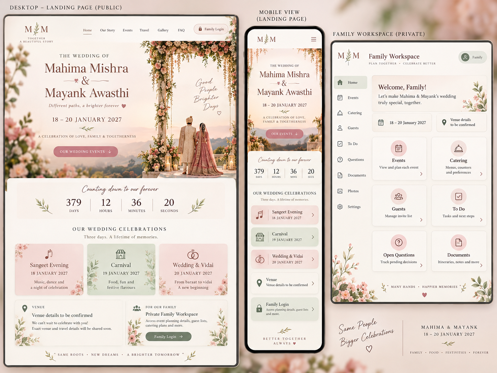
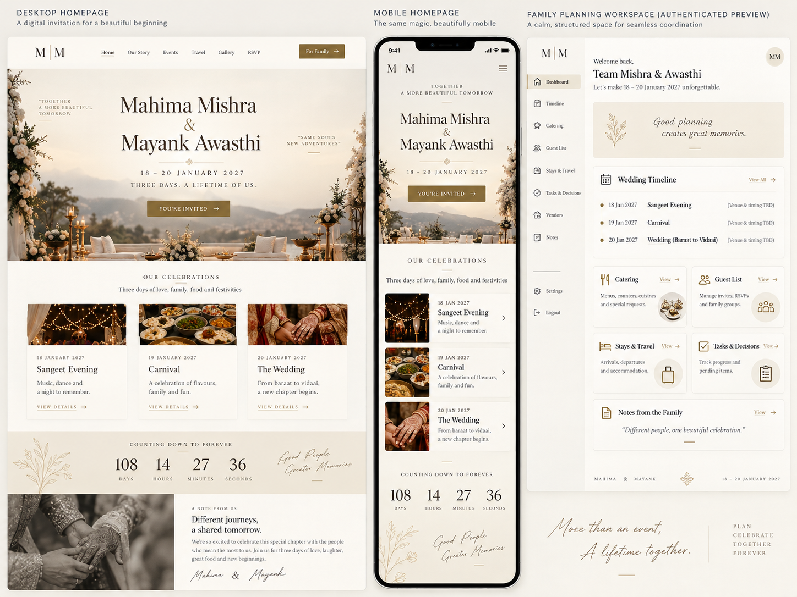
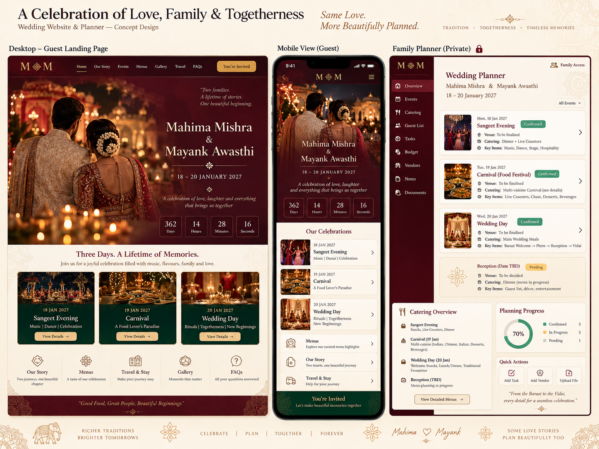
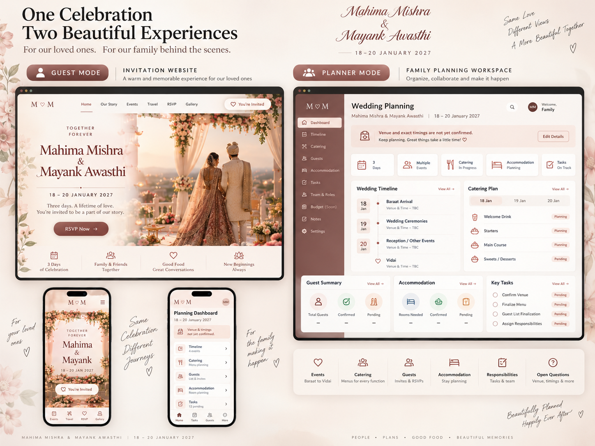

# Wedding UI/UX prototypes — original images

Four **original generated PNG mockups** for Mahima Mishra and Mayank Awasthi's wedding website. These are the actual reference images from the design discussion, preserved unchanged, not SVG recreations.

## 01 — Romantic Botanical

Ivory, blush, sage, florals and warm invitation-card styling. Public invitation, mobile view and private planning preview.

## 02 — Editorial Ivory

Minimal cream and gold, generous whitespace, refined serif typography. Calm public invitation with structured family workspace.

## 03 — Regal Indian Celebration

Deep maroon, warm gold and heritage-inspired festivities. More cinematic guest experience alongside a wedding planning dashboard.

## 04 — Contemporary Two-Mode

Unified design language with deliberately different experiences: a personal public invitation and a clear, private family-management workspace.

---

**For Codex:** These are alternative visual ideas, not implementation requirements or an approved final design. Compare the actual imagery and visual quality rather than copying every element. Some generated mockup text contains invented dates for ceremonies, venue assertions, countdown numbers, event confirmations or progress figures; those are **not verified facts**. The canonical wedding facts, provisional catering menus and open questions remain in [Wedding Record](../../WEDDING_RECORD.md). Do not promote illustrative mockup labels into real wedding data.
