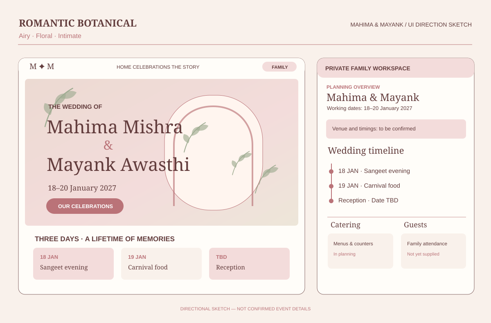
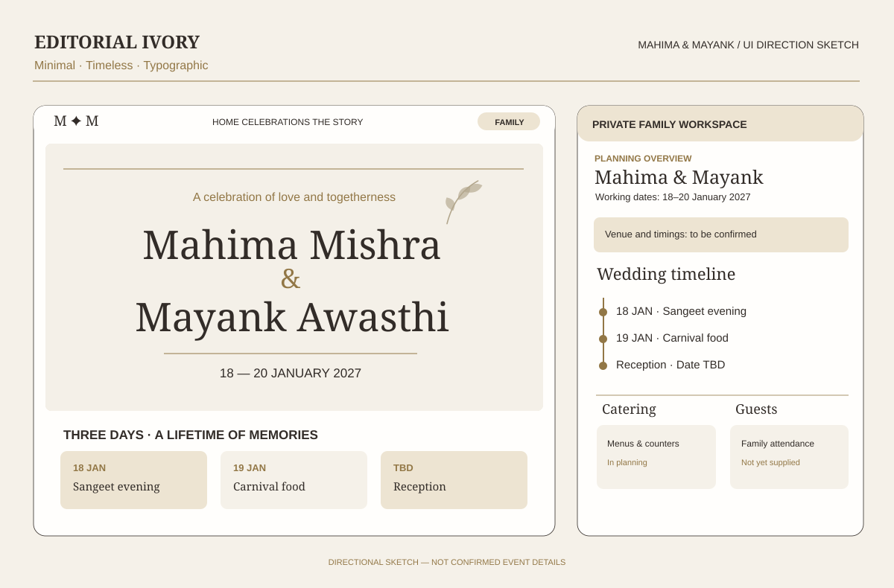
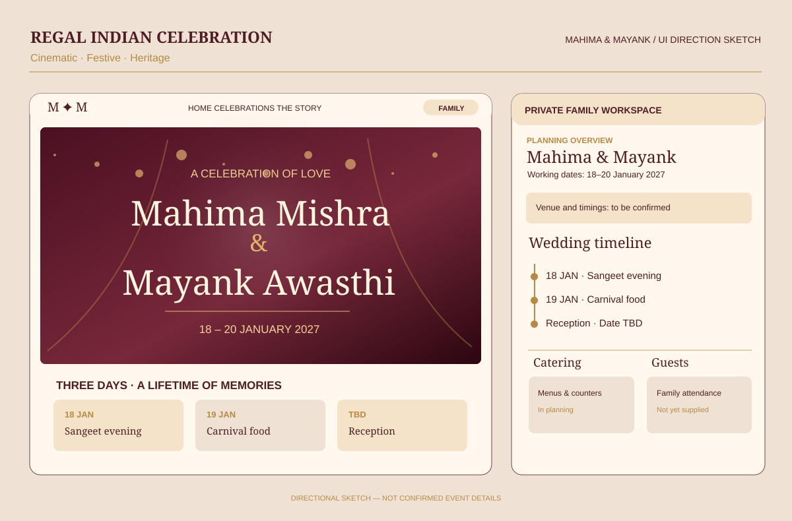
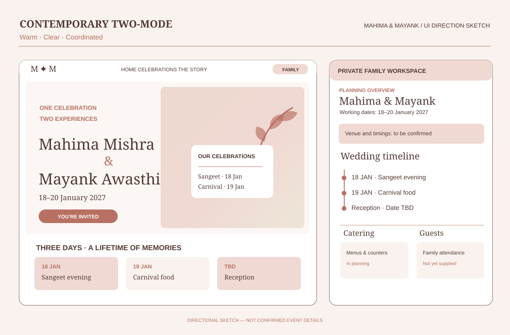

# Wedding UI/UX concept references

These **four different visual directions** are references for Codex to study and compare, **not approved templates, requirements, or a fixed composite to implement**. They cover the public invitation (emotion and hospitality), mobile presentation and the private family workspace (clarity and coordination).

| ID | Concept | Visual character | Best exploration opportunity |
| --- | --- | --- | --- |
| [01-romantic-botanical](./01-romantic-botanical.svg) | **Romantic Botanical** | Airy, Floral, Intimate | Soft ivory, blush and sage, botanical ornamentation, floral arches and invitation-card typography. A warm, intimate public experience; family workspace remains practical but visually related. |
| [02-editorial-ivory](./02-editorial-ivory.svg) | **Editorial Ivory** | Minimal, Timeless, Typographic | Whitespace-led editorial composition, elegant serif typography, slim dividers and reserved champagne/gold details. Quietly luxurious invitation; spare, structured planner interface. |
| [03-heritage-maroon](./03-heritage-maroon.svg) | **Regal Indian Celebration** | Cinematic, Festive, Heritage | Deep maroon, antique gold, restrained Indian decorative motifs, warm evening-light and festive imagery. Strong celebratory public site with a contrasting readable private dashboard. |
| [04-contemporary-two-mode](./04-contemporary-two-mode.svg) | **Contemporary Two-Mode** | Warm, Clear, Coordinated | One connected design language with intentionally different guest and family modes. Emotional public invitation alongside a stronger card-and-timeline operational workspace. |

## Visual references

### Romantic Botanical

Soft ivory, blush and sage, botanical ornamentation, floral arches and invitation-card typography. A warm, intimate public experience; family workspace remains practical but visually related.

**Original image from the ChatGPT concept discussion:** `mahima_mayank_wedding_ui_showcase.png`. The original generated raster board is available in the conversation, **not checked into this repository**; the linked SVG is a simplified, separately constructed visual reference and is **not** a copy of the original PNG. If detailed screenshot-level comparison is required, the original asset still needs to be transferred to the development workspace.

### Editorial Ivory

Whitespace-led editorial composition, elegant serif typography, slim dividers and reserved champagne/gold details. Quietly luxurious invitation; spare, structured planner interface.

**Original image from the ChatGPT concept discussion:** `elegant_wedding_planning_ui_board.png`. The original generated raster board is available in the conversation, **not checked into this repository**; the linked SVG is a simplified, separately constructed visual reference and is **not** a copy of the original PNG. If detailed screenshot-level comparison is required, the original asset still needs to be transferred to the development workspace.

### Regal Indian Celebration

Deep maroon, antique gold, restrained Indian decorative motifs, warm evening-light and festive imagery. Strong celebratory public site with a contrasting readable private dashboard.

**Original image from the ChatGPT concept discussion:** `indian_wedding_planner_mockup_board.png`. The original generated raster board is available in the conversation, **not checked into this repository**; the linked SVG is a simplified, separately constructed visual reference and is **not** a copy of the original PNG. If detailed screenshot-level comparison is required, the original asset still needs to be transferred to the development workspace.

### Contemporary Two-Mode

One connected design language with intentionally different guest and family modes. Emotional public invitation alongside a stronger card-and-timeline operational workspace.

**Original image from the ChatGPT concept discussion:** `elegant_two_mode_wedding_experience.png`. The original generated raster board is available in the conversation, **not checked into this repository**; the linked SVG is a simplified, separately constructed visual reference and is **not** a copy of the original PNG. If detailed screenshot-level comparison is required, the original asset still needs to be transferred to the development workspace.

## Shared product truths

- **Couple:** Mahima Mishra and Mayank Awasthi.
- **Working dates:** 18–20 January 2027, from initial menu sheets, pending invitation confirmation.
- **Actually evidenced:** Sangeet evening on 18 January; Carnival-labelled food section on 19 January; proposed Reception menu with **no date**.
- **Unconfirmed:** Reception date, wedding ceremony/vidai scheduling, countdown target, venue/location, event attendance/RSVP, and guest details.

**Mockups illustrate a visual mood, not verified facts.** Some original generated boards depict a specific wedding day on 20 January, a confirmed event status, fabricated countdown values, or a progress percentage. **None of those details are established**; do not propagate them to guest pages or internal records. Refer to [Wedding Record](../../WEDDING_RECORD.md) as the factual source, not these sketches.

## Interpretation for design work

Treat each concept as one possible expression rather than mixing every ornament, color and panel into a single cluttered interface. Evaluate the emotional experience and mobile legibility of the public invitation separately from the information hierarchy and usefulness of the family workspace. A guest should sense a personal celebration, not generic e-commerce; a family planner should surface accurate information without mimicking a generic enterprise dashboard.

No art direction has been selected by the family. The existing [project overview](../../README.md), [guest promise](../../guest-experience/README.md), [family promise](../../family-workspace/README.md) and domain/eval research remain authoritative for intent, real facts and quality boundaries.
